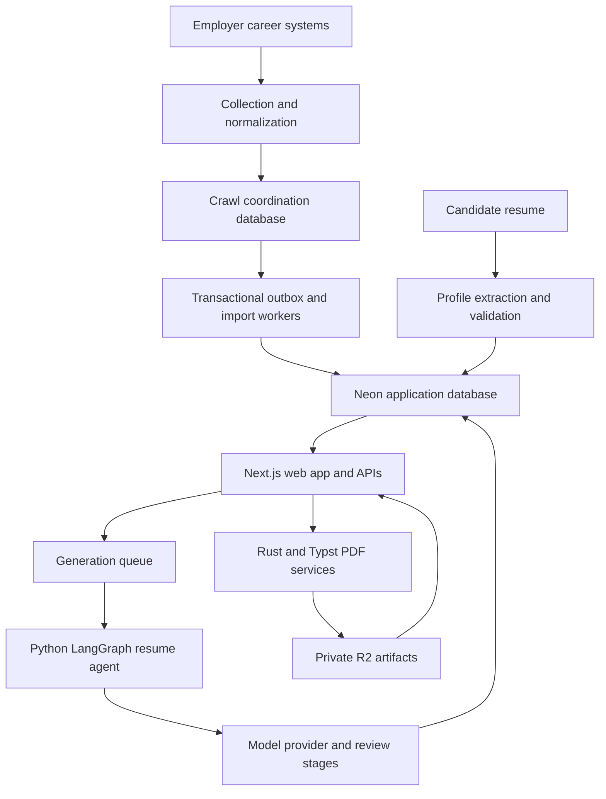

# Jobnex — Job Discovery and Evidence-Grounded AI Resume Tailoring

I build and maintain Jobnex, a full-stack job-search and resume-preparation platform. It combines employer job data, preference-based discovery, candidate profile management, AI-assisted resume tailoring, and editable PDF workflows.

**Public repository:** [github.com/jobnex/jobnex](https://github.com/jobnex/jobnex)

## What the platform does

Jobnex brings several parts of the job-search workflow into one application:

- Browse job listings and inspect full descriptions and application links.
- Search by job title or company and filter opportunities by supported job attributes.
- Maintain desired roles, skills, seniority, location and employment preferences.
- Discover curated matches using those preferences.
- Save opportunities and revisit requested resume work for selected jobs.
- Upload supported resume documents, inspect extracted content and correct candidate facts.
- Generate job-specific resume drafts grounded in the candidate's supplied experience.
- Review, edit, preview and export resumes through template-based document workflows.

## Main features

### 1. Job discovery and curated matching

The web application includes a public job board, saved jobs, a job-hunt dashboard and profile/preferences management. Search, filters, pagination, loading states, empty states and retry feedback are handled through typed API and UI layers.

The curated matching engine combines canonical role patterns, title token-pair matching and preference-based ranking. It supports strict, balanced and broad matching modes in the backend, alongside country/city, seniority, employment-type and date-window conditions. Ranking combines role eligibility, title-based skill signals, recency and deterministic tie breakers.

Requested-resume history is handled separately from general discovery so a candidate can return to previous work for a selected job. Saved-job actions and personalized routes use authenticated user identity.

### 2. Job ingestion and normalization

The repository includes a Python collector for employer career systems, company registries, sector coverage, detail collection and export workflows. Source integrations include systems such as Greenhouse, Lever, Ashby, Workday and other employer platforms.

Collection and enrichment work covers:

- Employer/source identifiers and job provenance.
- Full descriptions, company names, locations and application URLs.
- Disclosed salary and employment/workplace attributes when available.
- US-oriented geographic filtering and source-aware handling of ambiguous locations.
- Discovery versus refresh timestamps and the distinction between publication and update dates.
- Duplicate handling, retryable source failures and incremental collection.

The extended deployment also integrates a separately maintained Go/Freehire collector with parallel fetching and durable database delivery. That collector's source is separate from the verified public repository snapshot.

### 3. Durable parallel collection

The extended collector deployment separates crawl coordination from the application database. A transactional outbox carries normalized changes into production through supervised import workers.

Its engineering mechanisms include bounded worker stages, queue backpressure, hostname request limits, adaptive retry behavior, board leases, fencing tokens, retry backoff and per-posting event ordering. Import workers commit production updates before acknowledging delivery. Source identity and transaction controls support idempotent replay under at-least-once delivery.

Hot, warm and cold scheduling targets are configurable. The documented rollout used targets of two minutes, two hours and six hours respectively; actual completion depends on source behavior, backlog and rate limits.

### 4. Candidate profiles and resume extraction

Candidate profile workflows preserve structured resume information and editable source content. The extraction services include PDF and DOCX parsing capabilities, with acceptance constrained by the active upload path and validation contract.

The document-processing work includes contact extraction, URL normalization, education parsing, employment/project structure and content preservation during editing. Supported paths reject unsuitable or unsupported documents rather than treating failed extraction as a successful empty profile.

Private source information is scoped to its owner. Upload and replacement flows preserve the active source when validation fails and coordinate with in-progress generation work.

### 5. Evidence-grounded AI resume tailoring

The Python resume agent uses LangGraph to organize job-description analysis, source-fact mapping, project selection, drafting, review and bounded repair stages.

Key design choices:

- Candidate facts and generated claims carry provenance identifiers.
- Skills and factual claims are checked against source evidence.
- Numeric achievements require source evidence; fabricated metrics are not an acceptable shortcut.
- Deterministic validation complements semantic review.
- Repairs are bounded; unresolved outputs can be marked for review.
- Drafts, audits and generation history are persisted for later inspection.
- Optional project-library selection chooses relevant supplied projects while retaining provenance.
- Shared caching is limited to appropriate job-description analysis; private candidate facts and drafts are not placed in the shared JD cache.

Model access uses an OpenRouter-compatible interface. LangSmith integration records stages, latency, token use and cost, with controls for hiding private resume and job-description content from traces. Provider and model settings are deployment configuration, not a fixed platform guarantee.

### 6. Background processing and credit lifecycle

Resume generation is queued rather than tied to one long browser request. The application includes request IDs, generation status, retry/idempotency controls, worker leases and bounded per-user admission.

Credit handling separates reservation, settlement and failure recovery. The goal is to avoid duplicate reservations from retries or repeated clicks and to make incomplete requests visible. Exact billing behavior is versioned with the released service contract.

### 7. Resume editing, templates and PDF publication

The document workflow includes Markdown editing, structured preview components and template selection. The supported template family includes MIT CAPD, Modern Ivy, Minimalist Executive and Tech Specialist layouts.

Rust services and Typst support PDF compilation and publication workflows. The backend includes immutable previews, content hashes, revision/conflict checks and export of the selected preview artifact. Reusing an existing verified preview helps keep the exported PDF consistent with the preview the user selected.

Layout work includes contact wrapping, heading cleanup, education preservation and multi-page document handling. Availability of individual editor/layout improvements depends on the integrated frontend and backend release.

### 8. Private document storage

Cloudflare R2 provides S3-compatible private object storage for applicable document and preview workflows. The application uses ownership checks, user-scoped object keys and temporary signed URLs where supported.

Resume metadata and ownership remain in PostgreSQL. Generated/source objects are associated with the correct user and job, and backend PDF downloads include integrity checks. Storage credentials stay on trusted services.

### 9. Job-data enrichment

Background services enrich source jobs with additional evidence:

- **Visa sponsorship:** a Rust parser detects explicit sponsorship statements and stores classifications with evidence; queue processing preserves human review results.
- **Experience requirements:** a Rust parser distinguishes required, preferred and conditional experience, retains month-level quantities and education alternatives, and avoids inventing years from title seniority.
- **Processing state:** queues track pending work and support retryable, transactional batch processing.

Unknown or ambiguous evidence remains distinguishable from explicit zero experience or confirmed sponsorship.

## Technology stack

| Layer | Technologies |
| --- | --- |
| Web application | Next.js 16, React 19, TypeScript |
| Styling and components | Tailwind CSS 4, Base UI/shadcn components, Lucide, next-themes |
| Client data and state | TanStack Query, Zustand |
| Forms and validation | React Hook Form, Zod |
| Web/backend services | Next.js routes/actions, Node.js, TypeScript, Express in the standalone matching service |
| Profile extraction | Python, FastAPI, Pydantic, pypdf, pdfplumber, python-docx |
| AI workflows | Python 3.12+, LangGraph, OpenRouter-compatible model calls, LangSmith |
| Database | Neon PostgreSQL, Drizzle ORM, node-postgres, psycopg |
| PDF and enrichment services | Rust, Typst, Serde, PostgreSQL/S3-compatible adapters |
| Storage | Cloudflare R2, AWS SDK S3-compatible clients, signed URLs |
| Infrastructure | Docker, Google Cloud Run, Compute Engine, Cloud Build, Artifact Registry, Cloud Scheduler, Secret Manager, IAM |
| Extended collection deployment | Separately maintained Go/Freehire collector and PostgreSQL outbox workers |

## Architecture



This diagram combines repository components with the extended collection deployment; it is not a claim that every component runs inside one repository or one service.

## Engineering work and scale

- Worked with a production job catalog whose PostgreSQL planner estimate was approximately **1.48 million rows** during the October 28, 2026 performance investigation.
- Deployed an extended collector configuration that loaded **123,118 boards across 69 providers** during its verified rollout. These are loaded catalog entries, not a promise that every board succeeds or completes within every scheduling interval.
- Implemented and operated durable collection/import mechanisms with bounded concurrency, retries, restart recovery and source provenance.
- Investigated real PostgreSQL plans, including regex eligibility, trigram-index rechecks, full counts, ranking, sort spills and pagination.
- Performed scoped data-quality cleanup with frozen ID manifests, recovery branches, user-reference protections and post-operation reconciliation.
- Audited broad title filters and restored technical/ambiguous exceptions, then added regression protections against repeating those mistakes.
- Built document workflows with source grounding, validation, version history, artifact integrity and conflict-aware saves.

## Current development priorities

- Reduce curated API latency through reused counts, better candidate indexing and reusable matching results.
- Introduce a carefully validated ingestion policy for unwanted role families; prior database cleanup is not a permanent ingestion filter.
- Continue reviewing ambiguous titles and source-date semantics.
- Complete release-specific frontend/backend integration and representative browser/load checks.

Query-memory comparisons and matching optimizations from the latest diagnosis were diagnostic experiments. They have not been presented here as deployed production speedups. Role filtering, ATS suitability and resume quality remain evidence-based engineering problems rather than guarantees of employment outcomes.

## Explore the code

- [Application repository](https://github.com/jobnex/jobnex)
- [Web application](https://github.com/jobnex/jobnex/tree/main/app)
- [Shared application logic](https://github.com/jobnex/jobnex/tree/main/lib)
- [Resume agent](https://github.com/jobnex/jobnex/tree/main/resume-agent-inspect)
- [Background services](https://github.com/jobnex/jobnex/tree/main/services)
- [Python job collector](https://github.com/jobnex/jobnex/tree/main/techjobs)
- [Project documentation](https://github.com/jobnex/jobnex/tree/main/projectdocumentation)

## Run the web application locally

```bash
git clone https://github.com/jobnex/jobnex.git
cd jobnex
npm ci --ignore-scripts
cp .env.example .env.local
# Configure development Neon, authentication, storage and service settings.
npm run dev
```

The frontend starts at `http://localhost:3000`. Backend services, model credentials and database configuration require their documented setup. Use development resources and keep credentials out of Git.

## Skills demonstrated

Full-stack TypeScript development; React interfaces; API design; PostgreSQL query analysis; data ingestion; asynchronous workers; distributed-system reliability; Python AI orchestration; source-grounded generation; Rust services; document processing; private object storage; cloud deployment; observability; and recovery-oriented data maintenance.

---

## Short profile project card

**Jobnex — Job Discovery and AI Resume Tailoring**  
A full-stack platform combining employer job ingestion, preference-based discovery, candidate profile extraction, grounded AI resume generation and editable PDF workflows. Built with Next.js, React, TypeScript, Python/LangGraph, Rust, Neon PostgreSQL, Cloudflare R2 and Google Cloud. My work spans durable ingestion, queue reliability, document integrity, data-quality controls and SQL performance investigation.  
**Code:** [github.com/jobnex/jobnex](https://github.com/jobnex/jobnex)


## 🎯 Featured Projects

These are self-directed case studies and projects built with public, synthetic, or sample data to demonstrate end-to-end capabilities across Analytics, Engineering, and AI/ML.

### 🚀 [Real-Time Data Pipeline (Data Engineering)](https://github.com/Sudeepthi-Rongali/realtime-data-pipeline)
**Kafka | Flink | Iceberg | Trino | MinIO | Superset**  
A complex, real-time data pipeline architecture. Demonstrates streaming data systems and modern data lakehouse patterns.

### 🧠 [Local RAG Chatbot (AI/ML)](https://github.com/Sudeepthi-Rongali/local-rag-chatbot)
**Python | LangChain | LLMs | Vector Databases**  
A Retrieval-Augmented Generation (RAG) application to chat with multiple PDFs locally. Demonstrates document embedding, vector similarity search, and generative AI integration.

### 🤖 [Customer Churn Prediction (AI/ML)](https://github.com/Sudeepthi-Rongali/customer-churn-prediction-ml)
**Python | scikit-learn | XGBoost | FastAPI | Pandas**  
An end-to-end machine learning project to predict customer churn. Includes exploratory data analysis, feature engineering, model training (XGBoost/Random Forest), hyperparameter tuning, and a REST API deployment using FastAPI for real-time inference.

### ⚙️ [E-Commerce Data Pipeline (Data Engineering)](https://github.com/Sudeepthi-Rongali/ecommerce-data-pipeline)
**Python | Apache Airflow | BigQuery | dbt | SQL**  
A scalable ETL data pipeline that extracts raw e-commerce transaction data, transforms it using dbt for dimensional modeling, and loads it into a cloud data warehouse (BigQuery). Orchestrated with Apache Airflow to ensure daily automated data refreshes.

### 📊 [Health & Wellness Analytics Platform](https://sudeepthi-portfolio.netlify.app/projects/health-analytics/)
**Python | SQL | BigQuery | Cloud Run | REST APIs | Looker Studio**  
An end-to-end pipeline for wearable health data, with immutable raw ingestion, deduplication, calendar-spine modeling, data-quality checks, and rolling trend analysis. 

### 📈 [Sales Performance Dashboard](https://sudeepthi-portfolio.netlify.app/projects/sales-performance/)
**SQL | Power BI | DAX | Excel | Power Query | Python**  
An executive KPI dashboard that standardizes regional revenue and margin definitions, conforms product hierarchies, and uses price/volume/mix analysis to explain performance changes. 

### 🔍 [Customer Retention & Churn Analysis](https://sudeepthi-portfolio.netlify.app/projects/customer-retention/)
**Python | pandas | SQL | Power BI | Statistical Analysis**  
An analysis of cohort retention, behavioral segments, revenue at risk, and early churn signals. Focuses on feature breadth, first-30-day retention, and prioritizing retention effort by revenue exposure.
